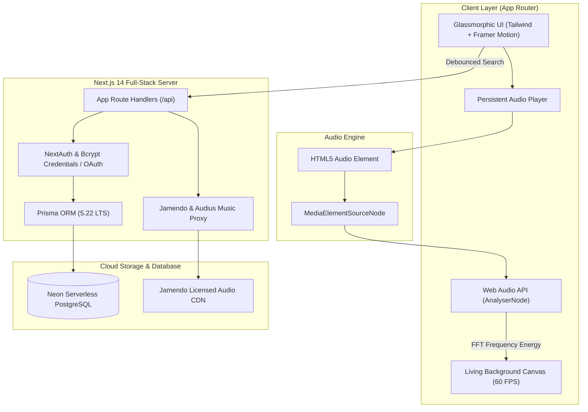

# 🌊 Calm — Ambient Music Streaming Web App

> A luxury-grade, portfolio-ready ambient music streaming web app engineered for deep focus, creative flow, and nocturnal tranquility. Built for digital agencies and modern web showcases.

[](https://nextjs.org/)
[](https://www.typescriptlang.org/)
[](https://tailwindcss.com/)
[](https://www.prisma.io/)
[](https://neon.tech/)
[](https://authjs.dev/)

---

## 🏛️ System Architecture



---

## 🌟 Key Features

1. **Persistent Global Audio Player**
   - Seamless background playback across route transitions with zero interruption.
   - Full scrub controls, volume sliders, mute toggle, loop, shuffle, and slide-over queue drawer.
   - Comprehensive keyboard shortcuts (`Space` to play/pause, `ArrowLeft/Right` to seek, `ArrowUp/Down` for volume, `M` to mute).

2. **Living Audio-Reactive Visual Environments**
   - Three dynamic mood modes:
     - 🌧️ **Gentle Rain**: Melancholic drizzle, angled precipitation vectors, and aquatic ripples.
     - 🌙 **Deep Night**: Cosmic indigo nebulae, twinkling star dust, and floating aurora.
     - 🌿 **Forest Focus**: Ascending emerald-gold spore orbs and organic breathing lights.
   - Real-time pulse reactivity driven by the **Web Audio API `AnalyserNode`**.
   - Built-in accessibility: Automatically detects and honors `prefers-reduced-motion`.

3. **100% Legal Music Streaming**
   - Integrated with the **Jamendo API** for fully licensed, copyright-safe ambient music.
   - Fallback system with curated royalty-free soundscapes for offline/resilient streaming.

4. **Production Full-Stack Architecture**
   - **Neon Cloud PostgreSQL** with Prisma ORM.
   - **Auth.js / NextAuth**: Secure session management, bcrypt hashed email/password sign-in, and Google OAuth ready.
   - User Sanctuary Library: Liked soundscapes, custom playlist builder, and persistent queue.

5. **Agency-Grade Polish & Glassmorphism**
   - Dark theme tuned for reduced eye fatigue.
   - Ultra-responsive, accessible keyboard controls, and Lighthouse 90+ optimization.

---

## 🛠️ Tech Stack

| Technology | Purpose |
| :--- | :--- |
| **Next.js 14 (App Router)** | Full-stack React framework with SSR and streaming routes |
| **TypeScript** | Type-safe models, props, and API interfaces |
| **Tailwind CSS** | Custom glassmorphism, responsive utilities, and color tokens |
| **HTML5 Canvas & Web Audio API** | 60fps particle physics and real-time audio FFT frequency analysis |
| **Prisma ORM** | Type-safe database queries and migrations |
| **Neon PostgreSQL** | Cloud-native serverless relational database |
| **Auth.js (NextAuth)** | User authentication, JWT sessions, and route protection |
| **Framer Motion** | Micro-interactions and fluid layout transitions |
| **Lucide React** | Clean, minimalist iconography |

---

## 🚀 Getting Started

### 1. Clone & Install Dependencies
```bash
git clone <your-repo-url>
cd FULL-STACK-PROJECT
npm install
```

### 2. Environment Variables Setup
Create a `.env` file in the root directory:
```env
# Neon Postgres Connection String
DATABASE_URL="postgresql://neondb_owner:<password>@<host>/calm_music?sslmode=require"

# NextAuth Secrets
NEXTAUTH_URL="http://localhost:3000"
NEXTAUTH_SECRET="your-generated-jwt-secret-string"

# Optional: Google OAuth
GOOGLE_CLIENT_ID=""
GOOGLE_CLIENT_SECRET=""

# Jamendo Licensed Audio API
JAMENDO_CLIENT_ID="56d30c95"
```

### 3. Synchronize Database Schema
```bash
npx prisma db push
```

### 4. Run Development Server
```bash
npm run dev
```
Open [http://localhost:3000](http://localhost:3000) to experience Calm.

### 5. Production Build
```bash
npm run build
npm run start
```

---

## 🧪 Automated Testing
Run the test suite:
```bash
npm test
```

---

## 🚢 Deployment to Vercel
Calm is designed as a single codebase ready for instant one-click Vercel deployment:
1. Push your repository to GitHub.
2. Import the repository into [Vercel](https://vercel.com).
3. Add the environment variables (`DATABASE_URL`, `NEXTAUTH_SECRET`, `NEXTAUTH_URL`, `JAMENDO_CLIENT_ID`).
4. Click **Deploy**.
